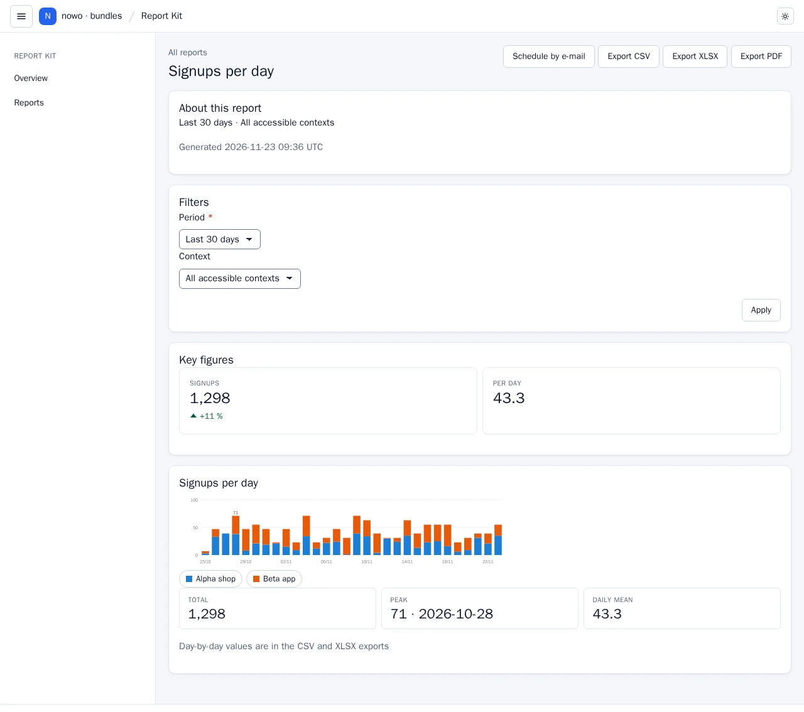
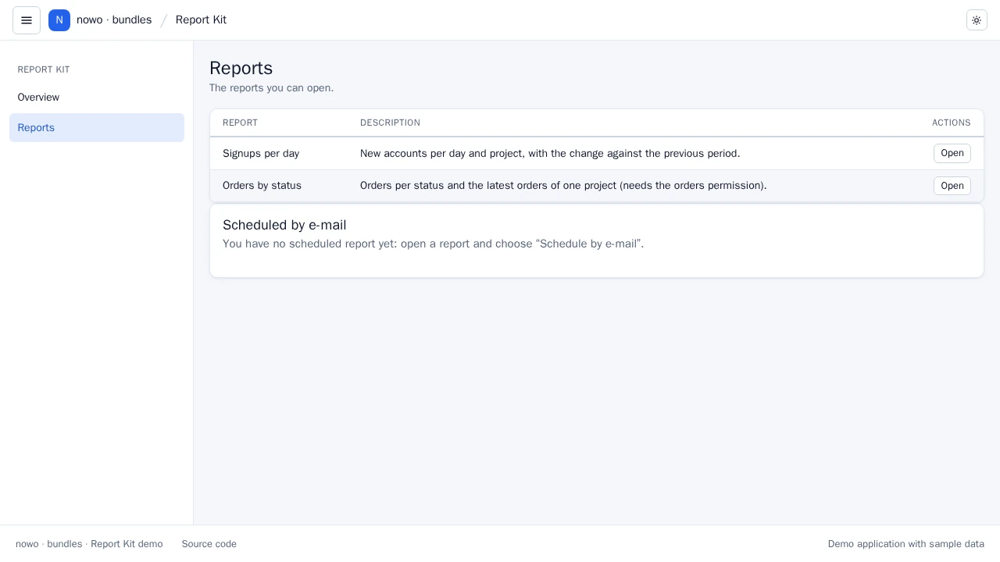

# Report Kit Bundle

[](https://github.com/nowo-tech/ReportKitBundle/actions/workflows/ci.yml) [](https://packagist.org/packages/nowo-tech/report-kit-bundle) [](https://packagist.org/packages/nowo-tech/report-kit-bundle) [](LICENSE) [](https://php.net) [](https://symfony.com) [](https://github.com/nowo-tech/ReportKitBundle) [](#tests-and-coverage)

> ⭐ **Found this useful?** [Install from Packagist](https://packagist.org/packages/nowo-tech/report-kit-bundle) · Give it a **star** on [GitHub](https://github.com/nowo-tech/ReportKitBundle) so more developers can find it.

**Reports and scheduled exports for Symfony: report types with parameter schemas, PDF / XLSX / CSV / JSON renderers, server-side SVG charts, on-screen report pages and per-owner scheduled e-mail subscriptions.**

> 🚧 **Status: S2 (pages), pre-1.0.** The package is built slice by slice from its design contract
> ([docs/CONTRACT.md](docs/CONTRACT.md), 221-C). S1 shipped the report model, the type registry and parameter schema,
> the CSV / XLSX / PDF / JSON renderers, SVG charts, the closed PDF runner and the brand resolver; S2 adds the scope and
> access SPIs, the report builder and the report pages with their export routes and rate limits. Subscriptions, the
> operator page and the API land with the next slices in [docs/ROADMAP.md](docs/ROADMAP.md).

> 📋 **Compatible with Symfony 7.4, 8.0 and 8.1** · PHP 8.2+ (Symfony 8.x requires PHP 8.4+)


This bundle is built for **FrankenPHP worker mode with the kernel kept alive and not reset between requests**: no
request state in services, a worker test (one kernel, 2,000 requests) and a worker export test (500 alternating PDF /
XLSX / CSV exports by two owners in two locales, no temporary file left, flat memory).

**Standard Symfony by default, DDD / hexagonal opt-in:** zero configuration in a standard project; public ports are
interfaces and value objects, bundle-owned tables are mapped in XML and referenced by id, the bundle never flushes your
EntityManager.



## Features

Available: the report model, the type registry with parameter schemas, every renderer, the SVG charts, the generic
PDF runner (S1) and the report pages with scope / access SPIs, export routes and rate limits (S2). Planned (see the
roadmap): subscriptions, operator page, bridges and the API.

- **Report model**: `Report` and `ReportSection` (key values with delta, tone and sparkline; tables with optional chart
  kind and presentation style; truncation note), badges, glance line, link.
- **Report type registry** (tagged `ReportTypeInterface`) with a parameter schema (periods, context, typed extras),
  availability per viewer and a configurable menu order.
- **Renderers**: PDF (closed Dompdf: no remote, no JavaScript, no PHP, private chroot), XLSX (OpenSpout streaming), CSV
  (UTF-8 BOM, formula-injection guard), JSON, and server-side SVG charts with light / dark variants. Dompdf and
  OpenSpout are suggested: a format is on only when its engine is installed (Q-O3).
- **Generic PDF runner** `PdfDocumentRendererInterface` for any template (invoices, receipts, mandates).
- **Pages** on UiKit + FormKit: report list, report page (filter form, Export menu; *Schedule by e-mail* dialog in S3),
  export routes with per-person rate limits, host SPIs for the contexts a person may report on and the permission per
  type.
- **Scheduled subscriptions**: daily / weekly / monthly at an hour in the owner's time zone, atomic claim, idempotent
  run per slot, built **as the owner** with an access re-check, branded mail to the owner only, auto-pause with a reason.
- **Operator page**, UserKit eraser and export, bridges for brand-contracts, MailKit, NotifyKit, AuditKit and
  ApiTokenBundle; optional public API `<prefix>/reports/v1` (off by default).

## Installation

```bash
composer require nowo-tech/report-kit-bundle
```

See [docs/INSTALLATION.md](docs/INSTALLATION.md). Nothing is registered while `nowo_report_kit.enabled` is false.

## Configuration

```yaml
# config/packages/nowo_report_kit.yaml
nowo_report_kit:
    enabled: true          # false (default) registers nothing
```

Write a report type and export it: [docs/USAGE.md](docs/USAGE.md).

Every key of the contract is already accepted (strict tree): [docs/CONFIGURATION.md](docs/CONFIGURATION.md).

## Documentation

- [Installation](docs/INSTALLATION.md)
- [Configuration](docs/CONFIGURATION.md)
- [Usage](docs/USAGE.md) (incl. using it from a DDD / hexagonal application)
- [Templates](docs/TEMPLATES.md)
- [Contributing](docs/CONTRIBUTING.md)
- [Code of Conduct](CODE_OF_CONDUCT.md)
- [Changelog](docs/CHANGELOG.md)
- [Upgrading](docs/UPGRADING.md)
- [Release](docs/RELEASE.md)
- [Security](docs/SECURITY.md)
- [Engram](docs/ENGRAM.md)
- [Spec-driven development](docs/SPEC-DRIVEN-DEVELOPMENT.md)
- [GitHub Spec Kit](docs/SPEC-KIT.md)
- [Roadmap](docs/ROADMAP.md) (slices and open questions)

### Additional documentation

- [Design contract (221-C)](docs/CONTRACT.md)
- [Architecture](docs/ARCHITECTURE.md)
- [PSR evaluation (REQ-CS-007)](docs/PSR.md)
- [Demo with FrankenPHP](docs/DEMO-FRANKENPHP.md)
- [FrankenPHP worker audit (kernel not reset)](docs/FRANKENPHP-WORKER-AUDIT.md)
- [Concurrency (REQ-RUNTIME-003)](docs/CONCURRENCY.md)
- [GitHub Actions CI requirements](docs/GITHUB_CI.md)

## Requirements

- PHP >= 8.2, < 8.6
- Symfony 7.4, 8.0 or 8.1

## Demo

`demo/symfony8`: Symfony 8.1, FrankenPHP worker mode, MySQL, on http://localhost:8223 (`make -C demo up`). The demo shell is UiKit; sign in as `alice` or `bob` (demo users, no password) and open `/reports`. Run the Playwright e2e with `make test-e2e` and refresh the screenshots with `make demo-screenshots`.



## Tests and coverage

```bash
make test               # PHPUnit in Docker
make test-coverage-100  # fails below 100 % of src/
make release-check      # every gate, demo included
```

- Tests: PHPUnit (unit, golden files for CSV / XLSX / JSON, PDF text extraction, Dompdf-closed tests, integration: kernel, both host kinds, database on SQLite / MySQL / PostgreSQL, kept-alive worker and worker export loop)
- PHP: 100% (gate `make test-coverage-100`)
- TS/JS: N/A
- Python: N/A

## License

MIT. See [LICENSE](LICENSE).

## Author

Created by [Héctor Franco Aceituno](https://github.com/HecFranco) at [Nowo.tech](https://nowo.tech).
